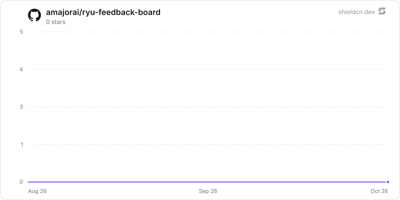

<div align="center">

# feedback-board

</div>

A public feedback board and private Ryu product workspace: collect requests, votes, and comments, turn demand into a roadmap, and use configurable Ryu workflows to prepare or build what users ask for.

> **The public home of `ryu-feedback-board`.** Source, builds, and releases live here —
> binaries for every platform are attached to each release.
>
> This tree is generated from the Ryu monorepo, so commits pushed here
> directly are replaced on the next sync. **Pull requests are welcome** —
> open them here and they are ported into the monorepo, then flow back out.
> Ryu as a whole: https://github.com/amajorai/ryu

## Install

**App:** [Install](ryu://apps/com.ryu.feedback-board) (opens the Ryu desktop app and asks you to confirm)

**CLI:**

```bash
ryu apps add com.ryu.feedback-board
```

**From source:**

```bash
cargo build --release --manifest-path backend/Cargo.toml
```

Prebuilt binaries for every platform are attached to [each release](https://github.com/amajorai/ryu/releases).

## License

Apache-2.0 — see [LICENSE](./LICENSE).

## The loop

1. Share a public board at `/feedback/<board-slug>`.
2. Visitors submit requests, vote, and add context.
3. The Ryu companion triages, tags, deduplicates, and prioritizes requests.
4. A request can become a Space brief, a Blueprint-reviewed plan, or a
   configurable Ryu workflow run.
5. Planned and shipped status changes project back to the public roadmap and
   changelog.

## Package layout

- `manifest.json` is the runtime and permission contract.
- `backend/` is the standalone `ryu-feedback-board` sidecar and SQLite store.
- `ui/` contains the sandboxed admin companion and public portal source. The
  build emits one self-contained companion bundle and one public bundle; the
  public bundle is also carried by the sidecar source so the backend satellite
  can build without depending on Core.

## Ryu seams

The admin companion reaches its own sidecar through the generic `app:http`
bridge. It uses Ryu's existing `storage:kv`, Spaces, model, agent, workflow,
and Blueprint bridges. The sidecar has no dependency on `apps/core` and binds
to loopback; Core exposes its public API through the manifest's `public_mount`.

## Local checks

```sh
bun run --cwd apps-store/feedback-board/ui test
bun run --cwd apps-store/feedback-board/ui check-types
bun run --cwd apps-store/feedback-board/ui build
cargo test --manifest-path apps-store/feedback-board/backend/Cargo.toml
```

Build the companion before building the sidecar so the public bundle carriage
is refreshed:

```sh
bun run --cwd apps-store/feedback-board/ui build
cargo build --manifest-path apps-store/feedback-board/backend/Cargo.toml
```

## Current boundary

This release is node-local. It does not ship custom domains, hosted
multi-tenant provisioning, SSO, email delivery, or external integrations.

## At rest

`feedback-board.db` seals `request.author_email` per value (`encb:v1:`, store
`feedback-board.db`, bound to the request id) under the `@ryu/feedback-board` plugin subkey
Core delivers to the sidecar (`crypto:seal` in the sidecar's `host_api.grants`). Only the
admin views of a request open it; public pages, votes, comments, releases, triage, briefs and
merges read requests without the email, so they keep working when it does not open. Comment
emails are no longer stored: new comments write none, and existing ones are cleared when the
store opens. Titles, bodies, categories, tags and author names are public board content and
stay plaintext (board search runs in SQL over them); ids, statuses, counts and timestamps also
stay plaintext. Legacy emails are sealed when the store opens (resumable, idempotent), then the
WAL is truncated and freed pages are zeroed (`secure_delete` is on for every connection). An
email that does not open is left out of admin lists and counted (`/health`
`sealing.unreadable_rows`). Key states (`backend/src/seal_keys.rs`):

- **Compat mode**: under an older Core that delivers no key, a never-sealed store keeps working
  in plaintext and `/health` reports `sealing.state = "compat"` ("waiting for a Ryu update").
- **No key or another key for a sealed store**: `sealing.state = "unhealthy"`; a new email is
  refused (requests without one are still accepted) and the data is kept.
- **Standalone** (no `RYU_PLUGIN_DATA_DIR`): `RYU_MASTER_KEY` if set, else a generated root in
  `<plugin data dir>/secrets/standalone-root.key` (0600) whose key check value is pinned.

The standalone satellite mirror builds `ryu-crypto` from crates.io at the declared version, so
the release train that ships this must publish `ryu-crypto` first (already ordered before app
backends in `tools/publish-crates.sh`).

## Star History

<a href="https://github.com/amajorai/ryu-feedback-board/stargazers">
  <picture>
    <source media="(prefers-color-scheme: dark)" srcset="./.github/shieldcn/star-chart-dark.svg" />
    
  </picture>
</a>
